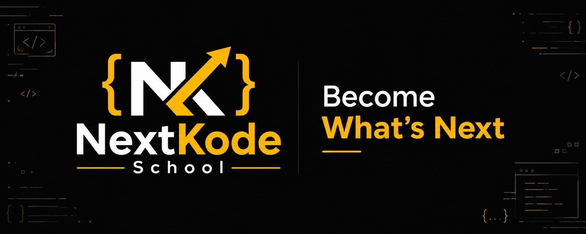

# 🚀 NextKodeSchool --- DevOps Engineer Program

### Learn · Build · Automate · Deploy

**40 Practical Classes \| 2--2.5 Months \| Beginner to Real-Time Project
Deployment**

------------------------------------------------------------------------

<!-- LOGO -->

## 🎯 About the Program

This practical DevOps program takes learners from Linux fundamentals to
deploying applications on AWS and Kubernetes. Students work with
industry-relevant tools and learn how to manage infrastructure, automate
workflows, containerize applications, and build CI/CD pipelines.

**Learning approach:** Less theory, more hands-on practice with real
tools and guided implementation.

## 🛠️ Technologies Covered

| Category | Technology |
|---|---|
| Operating System |  **Linux** |
| Shell Scripting |  **Bash** |
| Cloud Computing |  **AWS** |
| Networking |  **Networking** |
| Version Control |  **Git** |
| Source Code Management |  **GitHub** |
| Infrastructure as Code |  **Terraform** |
| CI/CD Automation |  **GitHub Actions** |
| Containerization |  **Docker** |
| Container Orchestration |  **Kubernetes** |

------------------------------------------------------------------------

# 📚 Detailed Course Content

## Module 1 --- Linux Administration

**Category:** Operating Systems · Linux System Administration\
**Classes:** 01--07

Learn Linux from the ground up, moving from command-line fundamentals to
managing and deploying applications on a Linux server.

  ------------------------------------------------------------------------
                         Class Topic                 What You'll Learn
  ---------------------------- --------------------- ---------------------
                            01 Introduction to Linux What is Linux, Linux
                                                     distributions,
                                                     terminal, shell, and
                                                     why Linux is
                                                     important in DevOps.

                            02 Linux Basic Commands  Navigation, listing
                               & File Management     files, creating,
                                                     copying, moving,
                                                     deleting files and
                                                     directories;
                                                     essential commands
                                                     and filters.

                            03 Linux File System:    Linux directory
                               Absolute & Relative   hierarchy, absolute
                               Paths                 paths, relative
                                                     paths, and navigating
                                                     important directories
                                                     such as `/etc`,
                                                     `/var`, `/home`, and
                                                     `/tmp`.

                            04 Vim Editor            Vim modes, creating
                                                     and editing files,
                                                     saving changes,
                                                     searching, and basic
                                                     navigation.

                            05 Linux Users, Groups & Users and groups,
                               Permissions           ownership, `chmod`,
                                                     `chown`, `sudo`, and
                                                     permission
                                                     management.

                            06 Linux Software &      Installing, updating,
                               Package Management    and removing
                                                     packages; APT and
                                                     YUM/DNF; managing
                                                     software
                                                     repositories.

                            07 Linux Web Server &    Nginx introduction,
                               Static Website        web server
                               Deployment            configuration,
                                                     deploying a static
                                                     website, ports, and
                                                     accessing the
                                                     application.
  ------------------------------------------------------------------------

## Module 2 --- Shell Scripting

**Category:** Shell Scripting · Linux Automation\
**Classes:** 08--10

Learn to automate repetitive Linux administration tasks using Bash
scripts.

  ------------------------------------------------------------------------
                         Class Topic                 What You'll Learn
  ---------------------------- --------------------- ---------------------
                            08 Introduction to Shell Bash, shell scripts,
                               Scripting             script execution,
                                                     shebang, and
                                                     executable
                                                     permissions.

                            09 Shell Scripting:      Variables, positional
                               Variables & User      arguments, command
                               Input                 substitution, and
                                                     accepting user input.

                            10 Shell Scripting:      `if`, `elif`, `else`,
                               Conditions &          comparison operators,
                               Scheduling            practical automation,
                                                     and scheduling
                                                     scripts using
                                                     Crontab.
  ------------------------------------------------------------------------

## Module 3 --- AWS Cloud Computing

**Category:** Cloud Computing · Amazon Web Services\
**Classes:** 11--18

Understand cloud computing and learn to provision, manage, scale, and
monitor AWS infrastructure.

  ----------------------------------------------------------------------------
                         Class Topic                 What You'll Learn
  ---------------------------- --------------------- -------------------------
                            11 AWS Account Creation  AWS account setup,
                               & Cloud Introduction  billing alerts, Free Tier
                                                     awareness, cloud
                                                     computing, service
                                                     models, Regions, and
                                                     Availability Zones.

                            12 Amazon EC2            EC2 fundamentals,
                                                     instance types, launching
                                                     instances, key pairs, and
                                                     connecting to Linux
                                                     servers.

                            13 AWS IAM               Users, groups, roles,
                                                     policies, permissions,
                                                     and least-privilege
                                                     access.

                            14 AWS CLI               Installing and
                                                     configuring AWS CLI,
                                                     profiles, credentials,
                                                     and managing AWS
                                                     resources from the
                                                     terminal.

                            15 AWS Elastic Load      Application Load
                               Balancing             Balancer, listeners,
                                                     target groups, health
                                                     checks, and traffic
                                                     distribution.

                            16 AWS CloudWatch & SNS  Metrics, logs, alarms,
                                                     EC2 monitoring, SNS
                                                     notifications, and email
                                                     alerts.

                            17 Amazon Machine Images Creating custom AMIs,
                               (AMI)                 launching instances from
                                                     images, and reusable
                                                     server configurations.

                            18 Launch Templates &    Launch templates,
                               Auto Scaling Groups   minimum/desired/maximum
                                                     capacity, scaling
                                                     policies, and load
                                                     balancer integration.
  ----------------------------------------------------------------------------

## Module 4 --- Git & GitHub

**Category:** Version Control System · Source Code Management\
**Classes:** 19--21

Learn how developers manage source code, track changes, and collaborate
through Git and GitHub.

  ------------------------------------------------------------------------
                         Class Topic                 What You'll Learn
  ---------------------------- --------------------- ---------------------
                            19 Introduction to Git & Version control, Git
                               GitHub                vs GitHub,
                                                     installation,
                                                     configuration, and
                                                     repositories.

                            20 Git & GitHub Core     `init`, `add`,
                               Concepts              `commit`, `push`,
                                                     `pull`, `clone`,
                                                     branches, merging,
                                                     and merge conflicts.

                            21 GitHub Pages          Hosting static
                                                     websites, repository
                                                     configuration, and
                                                     publishing websites
                                                     using GitHub Pages.
  ------------------------------------------------------------------------

## Module 5 --- Terraform & Infrastructure as Code

**Category:** Infrastructure as Code · Cloud Automation\
**Classes:** 22--27

Learn to provision and manage cloud infrastructure through reusable
Terraform configurations.

  -------------------------------------------------------------------------
                         Class Topic                 What You'll Learn
  ---------------------------- --------------------- ----------------------
                            22 Introduction to       Infrastructure as
                               Terraform & IaC       Code, Terraform
                                                     architecture,
                                                     providers, resources,
                                                     installation, and
                                                     first deployment.

                            23 Terraform Project     `.tf` files,
                               Structure             providers, variables,
                                                     outputs, `init`,
                                                     `plan`, `apply`, and
                                                     state fundamentals.

                            24 Terraform Modules     Root and child
                                                     modules, reusable
                                                     infrastructure, input
                                                     variables, outputs,
                                                     and module references.

                            25 Terraform             Dev, QA, and
                               Environments          Production
                                                     environments,
                                                     environment-specific
                                                     variables, and
                                                     workspaces.

                            26 Website Deployment    Provisioning AWS
                               Using Terraform       networking and EC2
                                                     resources and
                                                     deploying a website
                                                     through Terraform.

                            27 Terraform Import &    Importing existing
                               State Management      resources, state
                                                     files, remote state,
                                                     state locking, and
                                                     safe state management.
  -------------------------------------------------------------------------

## Module 6 --- CI/CD with GitHub Actions

**Category:** Continuous Integration · Continuous Delivery · DevOps
Automation\
**Classes:** 28--29

Automate infrastructure workflows using GitHub Actions.

  ------------------------------------------------------------------------
                         Class Topic                 What You'll Learn
  ---------------------------- --------------------- ---------------------
                            28 Introduction to CI/CD CI/CD fundamentals,
                               & GitHub Actions      workflows, events,
                                                     jobs, runners, steps,
                                                     and creating a
                                                     workflow.

                            29 Terraform CI/CD with  Automating Terraform
                               GitHub Actions        validation and plans,
                                                     deployment workflows,
                                                     AWS credentials, and
                                                     GitHub Secrets.
  ------------------------------------------------------------------------

## Module 7 --- Docker & Containerization

**Category:** Containerization · Application Deployment\
**Classes:** 30--33

Learn to package applications into containers and automate image build
and delivery workflows.

  ------------------------------------------------------------------------
                         Class Topic                 What You'll Learn
  ---------------------------- --------------------- ---------------------
                            30 Introduction to       Containerization,
                               Docker                containers vs virtual
                                                     machines, Docker
                                                     architecture, Docker
                                                     Engine, and Docker
                                                     Hub.

                            31 Docker Images &       Dockerfiles, building
                               Application           images, running
                               Deployment            containers, image
                                                     tagging, pushing and
                                                     pulling images from
                                                     Docker Hub.

                            32 Docker Compose &      Compose files,
                               Networking            multi-container
                                                     applications, bridge
                                                     and host networking,
                                                     and container
                                                     communication.

                            33 Docker CI/CD with     Automated image
                               GitHub Actions        builds, Docker Hub
                                                     integration, GitHub
                                                     Secrets, and image
                                                     publishing workflows.
  ------------------------------------------------------------------------

## Module 8 --- Kubernetes & Amazon EKS

**Category:** Container Orchestration · Cloud-Native Technologies\
**Classes:** 34--37

Learn to deploy, expose, scale, and manage containerized applications
using Kubernetes.

  ------------------------------------------------------------------------
                         Class Topic                 What You'll Learn
  ---------------------------- --------------------- ---------------------
                            34 Introduction to       Container
                               Kubernetes            orchestration,
                                                     Kubernetes
                                                     architecture, Control
                                                     Plane, Worker Nodes,
                                                     Pods, and `kubectl`.

                            35 Kubernetes Objects,   Pods, Deployments,
                               K3s & Application     ReplicaSets,
                               Deployment            Services, ConfigMaps,
                                                     Secrets, K3s cluster
                                                     setup, and port
                                                     forwarding.

                            36 Amazon EKS Cluster    EKS architecture,
                               Setup                 cluster setup,
                                                     configuring
                                                     `kubectl`, connecting
                                                     from a local machine,
                                                     and application
                                                     deployment.

                            37 Advanced Kubernetes   Namespaces, Ingress,
                               Topics                Persistent Volumes,
                                                     autoscaling, resource
                                                     requests and limits,
                                                     probes, Helm, and
                                                     troubleshooting.
  ------------------------------------------------------------------------

## Module 9 --- Real-Time DevOps Project

**Category:** Practical Implementation · End-to-End DevOps Deployment\
**Classes:** 38--40

Bring the tools together to build and deploy an application through a
practical DevOps workflow.

  ------------------------------------------------------------------------
                         Class Topic                 What You'll Learn
  ---------------------------- --------------------- ---------------------
                            38 Project Deployment    Project architecture,
                               --- Part 1            source code
                                                     management, AWS
                                                     infrastructure
                                                     provisioning with
                                                     Terraform, Docker
                                                     image creation, and
                                                     registry publishing.

                            39 Project Deployment    Kubernetes
                               --- Part 2            deployment, Services,
                                                     Ingress, GitHub
                                                     Actions CI/CD
                                                     integration,
                                                     monitoring, and
                                                     troubleshooting.

                            40 Final Project Review  End-to-end
                               & Best Practices      architecture
                                                     walkthrough, pipeline
                                                     review, security,
                                                     monitoring, cost
                                                     awareness,
                                                     troubleshooting, and
                                                     project presentation.
  ------------------------------------------------------------------------

------------------------------------------------------------------------

## 🏁 What You'll Be Able to Do

By the end of this program, you will have practical experience in:

-   Managing Linux servers and deploying websites.
-   Writing Bash scripts to automate routine tasks.
-   Provisioning and managing AWS cloud resources.
-   Monitoring cloud infrastructure and configuring alerts.
-   Managing source code with Git and GitHub.
-   Automating infrastructure using Terraform.
-   Building CI/CD workflows using GitHub Actions.
-   Building and publishing Docker images.
-   Deploying and managing applications on Kubernetes and Amazon EKS.
-   Bringing the complete DevOps workflow together in a practical
    project.

## 🎓 Program Overview

<table>
  <tr>
    <td width="33%" align="center" bgcolor="#161B22">
      <h3>🚀 Program</h3>
      <strong>DevOps Engineer Program</strong>
    </td>
    <td width="33%" align="center" bgcolor="#161B22">
      <h3>⏳ Duration</h3>
      <strong>2–2.5 Months</strong>
    </td>
    <td width="33%" align="center" bgcolor="#161B22">
      <h3>📚 Curriculum</h3>
      <strong>40 Practical Classes</strong>
    </td>
  </tr>
  <tr>
    <td width="33%" align="center" bgcolor="#161B22">
      <h3>💻 Learning Style</h3>
      <strong>Hands-on Training</strong>
    </td>
    <td width="33%" align="center" bgcolor="#161B22">
      <h3>🛠️ Tools & Technologies</h3>
      <strong>Linux · AWS · Git · Terraform</strong> 
      <strong>GitHub Actions · Docker · Kubernetes</strong>
    </td>
    <td width="33%" align="center" bgcolor="#161B22">
      <h3>🏆 Final Project</h3>
      <strong>End-to-End DevOps Deployment</strong>
    </td>
  </tr>
</table>
## 📞 Connect with NextKodeSchool

Have questions about the program or upcoming batch? Get in touch with
us.

-   **Website:** [nextkodeschool.com](https://nextkodeschool.com)
-   **Email:** <academy@nextkodeschool.com>
-   **Phone:** [+91 9493322788](tel:+919493322788)

### Learn. Build. Deploy. Repeat.

**Become What's Next with NextKodeSchool.**
